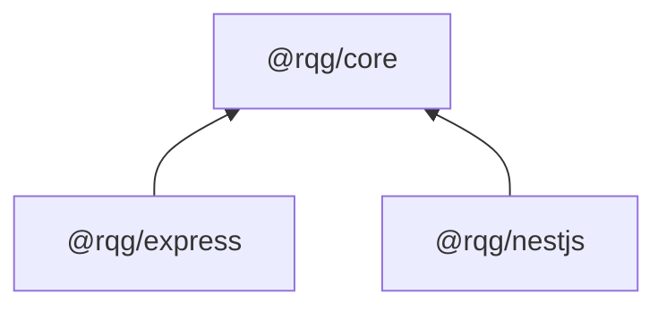

# rqg

[](https://github.com/zrira/rqg/actions/workflows/ci.yml)

A small TypeScript toolkit for exploring HTTP request protection and lifecycle design in Node.js, Express 5, and NestJS 11.

> **Project status:** This is an educational and portfolio project. It is feature-complete for its intended scope and is not actively maintained. Use in production at your own risk.

rqg was built to demonstrate framework-neutral primitives, defensive runtime validation, bounded in-memory state, HTTP transport lifecycle handling, and thin framework adapters. It is not a security product, WAF, authentication framework, distributed limiter, or substitute for edge-level protection.

## Architecture



`@rqg/core` contains no Express or NestJS imports. Adapters translate framework requests, dependency injection, and Node HTTP events into core operations.

| Package | Responsibility |
| --- | --- |
| `@rqg/core` | Request IDs, monotonic timing, structured logging, observability, fixed-window limiting, and bounded memory storage |
| `@rqg/express` | Express 5 request-ID, observability, rate-limit, and composed middleware |
| `@rqg/nestjs` | NestJS 11 module configuration, middleware, guards, decorators, and policy isolation |

## Features

- Canonical UUID v4 request IDs with explicit incoming-header trust.
- Monotonic operation timing and JSON-compatible structured logging.
- Node HTTP completion, failure, streaming, and abortion observation.
- Atomic anchored fixed-window rate limiting.
- Bounded process-local storage with predictable capacity failure.
- Express 5 standalone and composed middleware.
- NestJS 11 synchronous/async configuration, guards, decorators, and startup conflict validation.
- Fail-open or fail-closed operational policy.
- Defensive validation for configuration, identities, clocks, stores, loggers, and headers.
- Documented proxy, body-size, memory, and multi-instance boundaries.

## Requirements

- Node.js 22 or 24
- npm 10 or newer
- ESM consumers

## Install from GitHub

Each immutable package tag points to a package-root distribution generated from this monorepo. npm cannot select a workspace subdirectory from a normal Git URL, so do not install the source `v0.1.0` tag as a package.

### Core

```bash
npm install github:zrira/rqg#core-v0.1.0
```

### Express

```bash
npm install github:zrira/rqg#express-v0.1.0 express@^5
npm install --save-dev @types/express@^5
```

### NestJS

```bash
npm install github:zrira/rqg#nestjs-v0.1.0 \
  @nestjs/common@^11 @nestjs/core@^11 @nestjs/platform-express@^11 \
  reflect-metadata@^0.2 rxjs@^7.8
```

The adapter package tags depend on the immutable `core-v0.1.0` tag. GitHub Release tarballs are also produced for archival installation. See [GitHub distribution](docs/github-distribution.md).

## Core usage

```ts
import {
  createRateLimiter,
  createRequestId,
  createTimer,
} from '@rqg/core';

const requestId = createRequestId();
const timer = createTimer();
const limiter = createRateLimiter({ max: 100, windowMs: 60_000 });

const decision = await limiter.consume('tenant-123');
console.log({ requestId, durationMs: timer.stop(), decision });
```

## Express usage

```ts
import express from 'express';
import { getRequestId, rqg } from '@rqg/express';

const app = express();
app.set('trust proxy', false);
app.use(
  rqg({
    requestId: { acceptIncoming: false },
    observability: { logger: { log: console.log } },
    rateLimit: {
      max: 100,
      windowMs: 60_000,
      identity: (request) => request.ip,
    },
  }),
);
app.get('/', (_request, response) => {
  response.json({ requestId: getRequestId(response) });
});
app.listen(3000, '127.0.0.1');
```

## NestJS usage

```ts
import { Controller, Get, Module } from '@nestjs/common';
import { RateLimit, RequestId, RqgModule } from '@rqg/nestjs';

@Controller()
class AppController {
  @Get()
  @RateLimit({ max: 10, windowMs: 60_000 })
  get(@RequestId() requestId: string | undefined) {
    return { requestId };
  }
}

@Module({
  imports: [
    RqgModule.forRoot({
      requestId: { acceptIncoming: false },
      rateLimit: {
        global: false,
        max: 100,
        windowMs: 60_000,
        identity: (request) => request.ip,
      },
    }),
  ],
  controllers: [AppController],
})
export class AppModule {}
```

## Engineering notes

- [Architecture](docs/architecture.md)
- [Atomicity and concurrency](docs/concepts/concurrency-and-atomicity.md)
- [Node HTTP lifecycle](docs/concepts/node-http-lifecycle.md)
- [NestJS dependency injection](docs/concepts/nestjs-dependency-injection.md)
- [Runtime defensive programming](docs/concepts/defensive-programming.md)
- [Resource exhaustion](docs/concepts/resource-exhaustion.md)
- [Security model](docs/security.md)
- [Deployment security](docs/deployment-security.md)

## Limitations

- In-memory quotas are local to one store and one Node.js process.
- Restarts clear in-memory windows; workers and replicas do not coordinate.
- Distributed storage and distributed rate limiting are not implemented.
- Fastify integration is not supported.
- rqg does not parse bodies, authenticate users, prevent request smuggling, or mitigate volumetric DDoS attacks.
- Correct reverse-proxy trust, parser limits, timeouts, monitoring, and edge controls remain application responsibilities.
- There is no guaranteed maintenance, vulnerability-response, or support SLA.

## Development

```bash
npm ci
npm run format:check
npm run lint
npm run typecheck
npm test
npm run build
npm run test:consumers:packed
```

Build artifacts and temporary consumer projects are not committed.

## License

[MIT](LICENSE)
